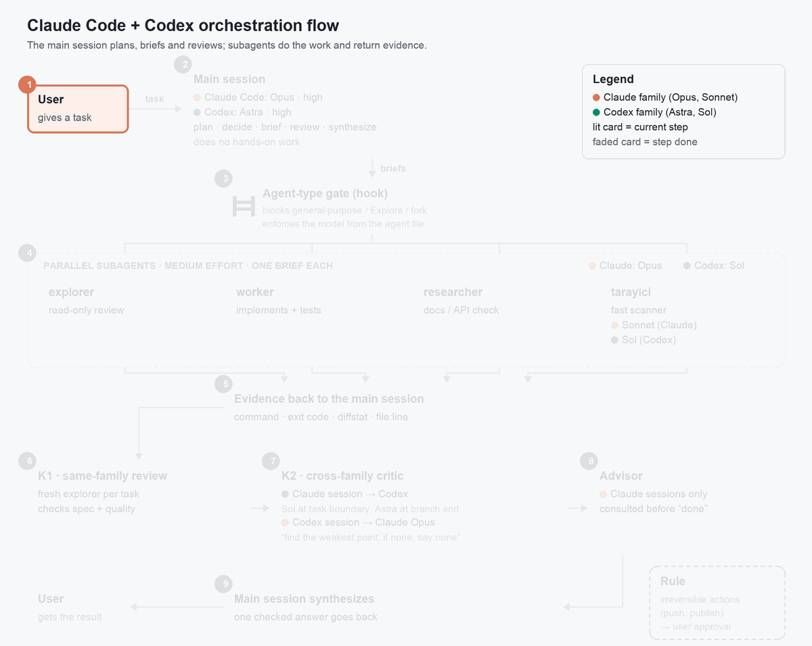

# claude-codex-orchestration

An orchestration skill, typed subagents and hooks for Claude Code and Codex CLI: the main session plans and reviews, subagents do the work, and a model from the other family critiques it.



Static version: [docs/assets/orchestration-flow.svg](docs/assets/orchestration-flow.svg)

## What it does

- **The main session orchestrates.** It plans, decides, writes briefs, reviews what comes back and synthesizes one answer. It does no hands-on work (exploring, editing, testing); that goes to subagents, so its context stays free for coordination.
- **Typed subagents** at medium effort: `explorer` (read-only judgement: code review, spec checks), `worker` (applies a decided change and runs its tests), `researcher` (checks current library, API and CLI behaviour), `scanner` (fast read-only search, maps and output summaries). On Claude Code a fifth, `fable-reviewer` (Fable at high effort, read-only), is used for two jobs only: the final whole-branch review and the final read of a plan or spec before it goes to the user; Codex uses a fresh `explorer` for both. General-purpose agent types are not used.
- **K1: same-family review** after each task, by a fresh subagent. The branch-end final review is the exception: on Claude Code `fable-reviewer` does it, on Codex a fresh `explorer`.
- **K2: cross-family critic.** From a Claude session the work goes to Codex (Astra or Sol); from a Codex session it goes to Claude Opus. It runs through `skills/orchestration/scripts/aile_elestirmen.py` and is mandatory for multi-task plans, multi-file changes, schema or gate changes and outbound output. With `--kayit` it writes one record line to the project ledger; `skills/orchestration/scripts/elestirmen_kayit_eki.py` later appends the decision (`· applied / parked (why)`) to that same line, under a shared lock.
- **Advisor** (Claude only, optional): consulted before declaring work done.
- **Irreversible actions** (push, deleting untracked files, writing outside the workspace or to an external system) need the user's approval.
- **Hooks:** agent-type gate, parallel-work reminder, read budget for the main session, superpowers version guard, and a load reminder when a subagent is opened before the skill was loaded.
- **Agent-type gate (Claude Code, every session, inside subagents too).** It denies the `general-purpose`, `Explore`, `Plan`, `claude` and `fork` types and an empty type (case-insensitive; a `<plugin>:<agent>` type is checked by its last part), and any `model` parameter other than `opus` or a full Opus id starting with `claude-opus-`. Every other type passes. Each denial message says how to turn the gate off: `ORCH_TIP_KAPISI=0`.
- **Image generation** through Codex's image tool (`skills/orchestration/scripts/gorsel_uret.py`).

The full rule book is `skills/orchestration/SKILL.md`; the reasons behind the rules are in `DECISIONS.md`.

## Requirements

- Claude Code and/or Codex CLI. It works with only one of them; the cross-family critic needs both.
- Python 3.9+. The Codex branch of the superpowers version guard needs 3.11+ (`tomllib`); below that it stays silent. Locks use `fcntl`, so macOS and Linux.
- The [superpowers](https://github.com/obra/superpowers) plugin is recommended. It is a separate project (MIT); this skill carries only a mapping table to it.
- Model access. Defaults are Opus and Sonnet on the Claude side and `gpt-6-astra` / `gpt-6.1-sol` on the Codex side. Change them in `skills/orchestration/scripts/modeller.json` and in the agent files (`agents/*.md`, `codex/agents/*.toml`).

## Install

Pick one mode. Do not install both the plugin and the user-level copy: the skill and hooks would load twice. `install.sh` refuses to do that.

What was measured: the local-clone path (`install.sh` in plugin and user-level mode, install and uninstall) in a temporary home inside a macOS sandbox without network. The GitHub source commands below (`0xRorschach/...`) were measured 2026-11-07 against the public repository with Claude Code 2.1.319 and Codex CLI 0.166.0, in a temporary home without credentials: marketplace add, install, details, update (already-latest case), uninstall; and clone + ./install.sh + --uninstall.

Not measured:

- an update across a real version change;
- Codex hooks firing in a live session after they are trusted with `/hooks`;
- the live behaviour of the hooks in a Claude Code session.

### Claude Code (native plugin)

```
/plugin marketplace add 0xRorschach/claude-codex-orchestration
/plugin install orchestration@claude-codex-orchestration
```

From the shell:

```sh
claude plugin install orchestration --marketplace 0xRorschach/claude-codex-orchestration
```

Plugin agents appear with the plugin prefix: `orchestration:explorer`, `orchestration:worker`, `orchestration:researcher`, `orchestration:scanner`, `orchestration:fable-reviewer`. The agent-type gate checks the last part, so these pass.

### Codex

```sh
codex plugin marketplace add 0xRorschach/claude-codex-orchestration
codex plugin add orchestration@claude-codex-orchestration
```

Codex plugins cannot ship agent roles, so a Codex plugin user still needs a clone of this repository for the roles: copy `codex/agents/*.toml` to `~/.codex/agents/` (or use `install.sh`, below). The custom role names `explorer` and `worker` take precedence over Codex's built-in roles of the same name ([Codex docs: subagents](https://learn.chatgpt.com/docs/agent-configuration/subagents)). Then open `/hooks` in Codex once and approve the new hooks: Codex skips hooks that are not trusted.

### One step for both

```sh
git clone https://github.com/0xRorschach/claude-codex-orchestration
cd claude-codex-orchestration
./install.sh
```

By default this installs plugin mode from the local clone for the tool(s) it finds and copies the Codex roles. Keep the clone: it is the marketplace source.

Options:

| Option | Effect |
|---|---|
| `--plugin` | Default. Registers the clone as a local marketplace, installs the plugin in each tool found and copies the Codex roles. |
| `--user-level` | No plugin. Copies the skill into `~/.agents/skills`, the agents and roles into `~/.claude/...` and `~/.codex/...`, and registers the hooks; existing config files are backed up first. |
| `--dry-run` | Shows what would change, changes nothing. |
| `--uninstall` | Removes what the script installed, as listed in its install record (see below). Works without `claude` / `codex` on `PATH`. |
| `--claude-only` | Claude Code only. |
| `--codex-only` | Codex only. |
| `--help` | Prints the usage text. |

`--plugin`, `--user-level` and `--uninstall` are modes: pick one. `--claude-only` and `--codex-only` exclude each other.

Exit codes:

| Code | Meaning |
|---|---|
| `0` | Done, or nothing to do. |
| `1` | Missing prerequisite (neither `claude` nor `codex` found, Python below 3.9); a `settings.json`, `hooks.json` or install record that does not parse (`cannot parse <file>: <error>; fix or move it and rerun`, checked before anything is written); a failed `claude` / `codex` command (`claude plugin install failed (exit N)`); a `settings.json` / `hooks.json` that is a broken symlink, or a folder where a file goes (both checked before anything is written); another `install.sh` running at the same time (`another install.sh is running (lock: <path>)`); or a file system error (for example a folder without write permission). |
| `2` | Usage error (unknown option, or `--claude-only` with `--codex-only`). |
| `3` | Would install twice (plugin and user-level copy together), or a path this script did not install is in the way: the message names the path and says to run `./install.sh --uninstall` or to move it away (`not installed by this script; move it away`). |

### Removing

Remove in the order shown.

Plugin installed from the marketplace, Claude Code:

```sh
claude plugin uninstall orchestration@claude-codex-orchestration
claude plugin marketplace remove claude-codex-orchestration
```

Codex:

```sh
codex plugin remove orchestration@claude-codex-orchestration
codex plugin marketplace remove claude-codex-orchestration
```

Then delete the copied roles `~/.codex/agents/{explorer,researcher,scanner,worker}.toml`, only if you copied them from this repository.

Installed with `install.sh`: `./install.sh --uninstall` is enough.

### Install record and uninstall

Every install writes `${XDG_STATE_HOME:-~/.local/state}/claude-codex-orchestration/install-record.json` (mode 0600). It lists the mode and tools, every file and folder the script created with its sha256, the skill copy (with a checksum of the whole folder and which tools use it), the Claude skills link, each hook entry it added to `settings.json` / `hooks.json` (the whole entry), the plugins and marketplaces it registered, and for every file it replaced the backup: path, original type, mode and, for a symlink, the link target. Backups go to `backups/<date>-<time>-<microseconds>-<pid>/<original absolute path>` next to the record (folder mode 0700). Each item is recorded as pending before it is written and confirmed after, so a run that stops half way still leaves a record that `--uninstall` can act on. While a run is active it holds a lock folder, `install.lock`, in the same place; a lock left by a process that no longer runs, or one without a pid that is older than 10 minutes, is taken over; otherwise the message names the lock to remove if no `install.sh` is running. Concurrent runs are refused; a takeover race between two runs that both find the same stale lock is not guarded.

`--uninstall` removes only what the record lists, and only while it is unchanged:

- A file or skill copy whose checksum no longer matches (you edited it) is left in place with a warning.
- A file the install replaced is put back from its backup, with its mode; a replaced symlink comes back as the same link.
- Only the hook entries the install added are taken out; an identical entry that was already there before the install stays, and so does a file that was already identical to ours.
- A pending item (from a run that stopped half way) is removed only if it holds exactly our content; otherwise it is the original and stays.
- Leftovers the record does not list (from such a run, or from an older install) are removed with a warning, for the tools this record installed, when they are exactly ours: files byte-identical to this repository's copies, and hook entries whose command is one of this repository's hook commands.
- Folders the install created are removed when empty. When nothing is left, the record itself is removed, and then the state folder `${XDG_STATE_HOME:-~/.local/state}/claude-codex-orchestration/` too if it is empty (after the lock is released); a state folder that still holds backups stays. A `settings.json` / `hooks.json` the install created and that holds nothing but our entries is removed without a backup; a file that holds anything else is backed up before it is rewritten.
- `--claude-only` / `--codex-only` limit the uninstall to one tool. The shared skill copy in `~/.agents/skills/orchestration` goes when the last tool that uses it is uninstalled.
- An existing symlink at a copied file (say `~/.codex/agents/worker.toml` pointing into a dotfiles folder) is replaced by the file itself; the file it pointed to is never written. A symlinked `settings.json` / `hooks.json` is written through, so the link stays. Rewritten JSON files keep their mode, their indent (2 when it cannot be read from the file) and their final newline, and non-ASCII text stays as it is; a `"hooks": {}` or event list that was there before the install stays after uninstall, while the ones the install created go.

After `git pull`: plugin mode needs the update step below; in `--user-level` mode run `./install.sh --user-level` again, which updates the recorded copy. `--uninstall` judges the skill copy against the checksum recorded at install, not against the current clone, so it still removes the copy after a `git pull` as long as you did not edit it.

Upgrading from an install without a record (made by an earlier version of `install.sh`): installing again stops with exit 3 and names what it found. In plugin mode that is the plugin or its marketplace already registered in Claude Code or Codex, or one of this repository's Codex roles in `~/.codex/agents` (`found an install without a record: run ./install.sh --uninstall first`). In `--user-level` mode it is the skill copy in `~/.agents/skills/orchestration` or the Claude skills link to it; an installed plugin also blocks `--user-level`. Run `./install.sh --uninstall` first: without a record it removes the plugin and marketplace by name, and otherwise only files byte-identical to this repository's copies and hook entries identical to ours, warning about the rest. Then install again.

After a plugin-mode uninstall, Claude Code and Codex keep their own bookkeeping files: an empty `installed_plugins.json` and `known_marketplaces.json`, `"enabledPlugins": {}` in `settings.json`, a plugin cache folder marked `.orphaned_at`, and Codex's `config.toml`. They belong to the tools, not to this script; in the sandbox measurement none of them still named this marketplace.

### Updating

Depends on how you installed:

- **From GitHub as a marketplace** (measured 2026-11-07 only in the already-latest case; an update across a real version change is not measured): Claude Code: `claude plugin marketplace update claude-codex-orchestration`, then `claude plugin update orchestration@claude-codex-orchestration` and restart the session. Codex: `codex plugin marketplace upgrade claude-codex-orchestration`, then `codex plugin add orchestration@claude-codex-orchestration` again. Copy the roles again if they changed.
- **From a local clone with `install.sh`:** `git pull`. Claude Code reads the plugin from the clone in place (restart the session). Codex keeps a cached copy: run `codex plugin add orchestration@claude-codex-orchestration` again. In `--user-level` mode run `./install.sh --user-level` again.

In both cases approve changed hooks in Codex with `/hooks`.

### Verify

```sh
claude plugin details orchestration@claude-codex-orchestration
codex plugin list
```

## Profile

Some defaults are preferences, not mechanism: for example, lower model tiers only on request, a threshold of 15 concurrent agents, Workflow (multi-agent scripts) only with explicit permission. `profile/profile.example.md` lists them with how to change each. Copy what you want into your CLAUDE.md (Claude Code) or AGENTS.md (Codex); lines there take precedence over the skill's defaults.

## Configuration

Environment variables (full details in `skills/orchestration/hooks/README.md` and `skills/orchestration/scripts/README.md`):

| Name | Used by | Meaning | Default |
|---|---|---|---|
| `ORCH_OKUMA_ESIGI` | read budget hook | Threshold in characters of read/command output in the main session; the note repeats at each multiple. | `40000` |
| `ORCH_OKUMA_BUTCESI` | read budget hook | `0` disables the hook. | on |
| `ORCH_MUAF_BETIKLER` | read budget hook | Extra exempt script file names, comma-separated (base name compared). | none |
| `ORCH_SURUM_BEKCISI` | superpowers version guard | `0` disables the hook. | on |
| `ORCH_HATIRLATICI` | load reminder | `0` disables the hook. | on |
| `ORCH_TIP_KAPISI` | agent-type gate | `0` disables the gate: every Agent call passes, nothing is logged. | on |
| `ORCH_PARALEL_HATIRLATICI` | parallel-work reminder | `0` disables the hook. | on |
| `ORCH_PARALEL_ESIK` | parallel-work reminder | Concurrent-agent threshold quoted in the reminder; invalid or non-positive values fall back to the default. | `15` |
| `ORCH_LOG_DIR` | agent-type gate, parallel-work reminder, load reminder | Log folder (and the state of the load reminder and the parallel-work reminder); wins over the plugin data folder. | plugin data folder, else a per-hook folder under the home directory |
| `ORCH_CODEX_BIN` | cross-family scripts | Codex binary to run. An absolute path must be executable; a bare name is looked up on `PATH`; a relative path is rejected. | `codex` |
| `ORCH_CLAUDE_BIN` | cross-family scripts | Claude binary to run, same rules. | `claude` |

## Names

File and environment variable names are Turkish in origin and kept on purpose: renaming would ripple through tests and hook registrations. A short glossary:

| Name | Meaning |
|---|---|
| `okuma_butcesi` | read budget |
| `aile_elestirmen` | family critic |
| `elestirmen_kayit_eki` | critic record suffix |
| `paralel-is-hatirlatici` | parallel-work reminder |
| `agent-tip-kapisi` | agent-type gate |
| `superpowers_surum_bekcisi` | superpowers version guard |
| `orkestrasyon_hatirlatici` | orchestration load reminder |
| `gorsel_uret` | image generation |
| `modeller` | models |
| K1 / K2 | critic layer 1 / critic layer 2 |

## Known limits

- The Codex read-only sandbox restricts writes, not reads: reading is not confined to the working directory. It also cannot run tests ("No usable temporary directory"), so the Codex critic verifies the worker's evidence instead of re-running the tests.
- Whether the Claude critic loads CLAUDE.md memory under `--restricted` is not verified. If it does, the critic shares instructions with the session that wrote the work, which reduces its independence.
- Codex plugins cannot ship agent roles; the roles are copied separately.
- Claude Code plugin agents get the `orchestration:` prefix.
- Measurements cited in `SKILL.md` and `DECISIONS.md` are small-n internal measurements, not benchmarks.
- `aile_elestirmen.py` copies `~/.codex/auth.json` into a private temporary home for each Codex call. If Codex refreshes the token, the new copy is written back only when the original file is unchanged since the call started. The lock behind that check coordinates only this script's own calls; the Codex CLI does not take it. A second Codex session on the same account running at the same time can therefore overwrite the refreshed token or keep it from being written back. Keep no other Codex session open during a critic call; after a credential error run `codex login`. The script never prints or sends the token.
- The agent-type gate denies `Plan` and `Explore` in every session. Built-in Claude Code flows that open such an agent themselves (plan mode, for example) may be blocked as well (not verified). Turn the gate off with `ORCH_TIP_KAPISI=0`.
- The advisor tool is optional and exists only on the Claude side.
- `fable-reviewer` needs access to the Fable model. If it cannot be opened (no Fable access, or the agent file did not load), use a fresh `explorer` for the same read and note it in the record.
- The critic record lock lives in `${XDG_CACHE_HOME:-~/.cache}/orchestration/kayit-kilit/` and needs write access there. In a sandbox without it, `aile_elestirmen.py --kayit` and `elestirmen_kayit_eki.py` exit 6 and print the reason (and, for `--kayit`, the unwritten line) to stderr.
- Load reminder: in Claude Code the note arrives with the first Agent call's result, so it shapes the later spawns, not the first one. In Codex it runs only after you trust it with `/hooks`.
- Codex plugin hook loading via `${PLUGIN_ROOT}` not measured in a live session: whether Codex hooks fire in a live session after they are trusted with `/hooks` is not measured, nor is the live behaviour of the hooks in a Claude Code session.

## Tests

Three suites; run these lines from the repository root (the parentheses keep each `cd` to its own line):

```sh
# install script tests
python3 -m unittest discover -s tests

# hook tests
(cd skills/orchestration && python3 -m unittest discover -s hooks/tests)

# script tests
(cd skills/orchestration/scripts && python3 -m unittest discover -s tests -t tests)
```

The install tests run `install.sh` in a temporary home directory; tests that need the real `claude` or `codex` binary are skipped when it is not on `PATH`. The network-denying sandbox profile uses macOS `sandbox-exec`; on Linux the install tests run without network isolation.

No real model is called; the script tests use fake `codex` and `claude` binaries, and the hook tests use a temporary home directory.

## Diagram

```sh
python3 tools/diagram/make_diagram.py
```

Regenerates `docs/assets/orchestration-flow.gif` and `docs/assets/orchestration-flow.svg`. Needs Pillow (`python3 -m pip install pillow`).

## Türkçe

Bu depo Claude Code ve Codex CLI için bir orkestrasyon skill'i, tipli alt ajanlar ve kancalar (hook) içerir. Ana oturum planlar, karar verir ve denetler; işi alt ajanlar yapar; önemli noktalarda öbür model ailesinden bir eleştirmen işi okur. Geri alınamaz eylemler (push, izlenmeyen dosya silme, dış sisteme yazma) kullanıcı onayı bekler.

Claude Code'a eklenti olarak kurmak için:

```
/plugin marketplace add 0xRorschach/claude-codex-orchestration
/plugin install orchestration@claude-codex-orchestration
```

Codex'e eklenti olarak kurmak için:

```sh
codex plugin marketplace add 0xRorschach/claude-codex-orchestration
codex plugin add orchestration@claude-codex-orchestration
```

Codex eklentisi ajan rollerini taşıyamadığı için `codex/agents/*.toml` dosyalarını `~/.codex/agents/` klasörüne kopyalayın ya da iki aracı tek adımda kurun:

```sh
git clone https://github.com/0xRorschach/claude-codex-orchestration
cd claude-codex-orchestration
./install.sh
```

Codex, kurulumdan sonra yeni kancaları siz Codex içinde bir kez `/hooks` açıp onlara güvenene kadar çalıştırmaz. Eklentiyi ve kullanıcı düzeyi kopyayı birlikte kurmayın, skill ve kancalar iki kez yüklenir (`install.sh` buna izin vermez).

Seçenekler, güncelleme ve doğrulama için [Install](#install), ayarlar için [Configuration](#configuration), bilinen sınırlar için [Known limits](#known-limits) bölümüne bakın. Kural kitabının Türkçe okuma kopyası [skills/orchestration/SKILL.tr.md](skills/orchestration/SKILL.tr.md) dosyasındadır; model İngilizce `SKILL.md`'yi yükler ve iki dosya ayrışırsa `SKILL.md` geçerlidir.

## Acknowledgements

- [superpowers](https://github.com/obra/superpowers) by Jesse Vincent (MIT). It is a separate plugin; this repository contains only a mapping table to its skills and copies no code from it.
- Inspiration: the Avenox video "Tek Ajan Yetmez: Ajan Ekibi Kurmanın 6 Seviyesi" (https://www.youtube.com/watch?v=zE_ggoUn7ao).

## License

MIT, see [LICENSE](LICENSE).
